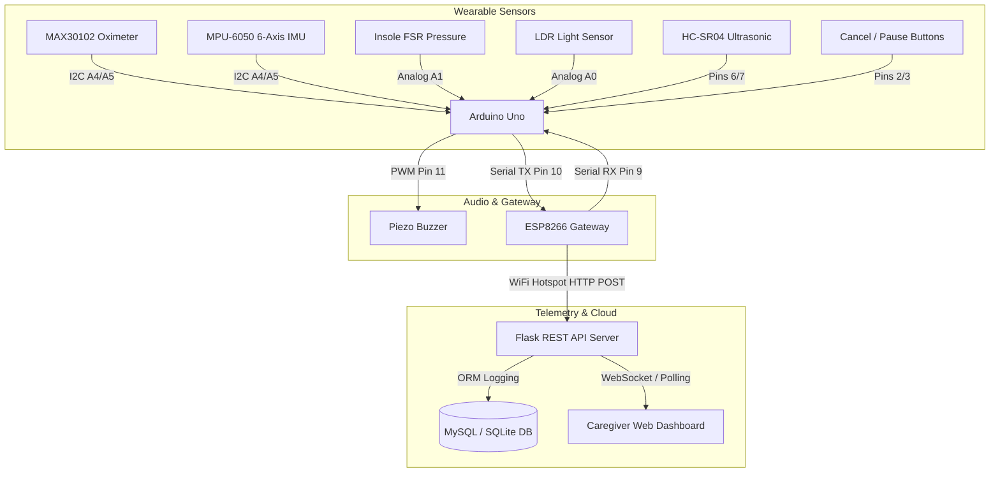

# Comprehensive Project Report: Elderly Wearable Health & Safety Monitoring System

**Project Title**: IoT-Enabled Wearable Multi-Factor Fall Detection & Physiological Illness Telemetry System  
**System Architecture**: Arduino Uno Microcontroller + ESP8266 (ESP-12E) Wireless Gateway + Python Decision Engine + Flask Web Dashboard  
**Date**: October 2026  

---

## Executive Summary

Falls and acute physiological collapses represent the leading causes of fatal and non-fatal injuries among elderly individuals worldwide. Conventional medical alert pendants frequently suffer from two critical limitations: high false-alarm rates during benign activities (such as sitting down, walking, or removing shoes) and an inability to correlate mechanical impacts with underlying medical crises (such as vasovagal syncope or sudden hypoxemia).

This project presents a multi-tiered, hardware-software integrated wearable system that addresses these limitations through:
1. **Multi-Factor Fall Detection Decision Engine**: Eliminates false alarms by evaluating four concurrent sensor signals: insole footwear pressure drop (FSR), 3D orientation tilt change from vertical to horizontal (MPU-6050), impact acceleration shock, and post-impact inactivity stillness.
2. **Gait Swing-Phase vs. Fall Rejection Filter**: Distinguishes normal walking swing phases (~300 ms unweighted foot) from genuine falls through a 1.2-second sustained non-recovery temporal threshold.
3. **Physiological Illness Anomaly Engine**: Monitors real-time heart rate and blood oxygen saturation ($SpO_2$) via a MAX30102 sensor, detecting acute bradycardia ($< 52\text{ BPM}$) and sudden hypoxia ($< 90\%$) that frequently trigger syncopal falls.
4. **Standalone Hardware Operation**: Decoupled from laptop tethering via an autonomous 5V powerbank and ESP8266 WiFi connection to a mobile hotspot.
5. **Interactive Web Telemetry Dashboard**: Modern dark-mode interface with a live 6-row Truth Table visualizer, 3D posture tilt avatar, audible alarm management, and caregiver audit log.

---

## 1. System Architecture & Hardware Connections

The system utilizes an Arduino Uno as the real-time sensor processing core and an ESP8266 module as the wireless telemetry bridge.



### 1.1 Complete Hardware Pin Assignment Table

| Component | Function | Arduino Uno Pin | ESP8266 Pin | Electrical Specs |
| :--- | :--- | :--- | :--- | :--- |
| **MAX30102** | Heart Rate & $SpO_2$ Photoplethysmography | $SDA \rightarrow A4$, $SCL \rightarrow A5$ | — | 3.3V Logic & Rail, $400\text{ kHz}$ I2C |
| **MPU-6050** | 6-Axis IMU (Accelerometer & Gyroscope) | $SDA \rightarrow A4$, $SCL \rightarrow A5$ | — | 5V VCC, 3.3V I2C, $\pm 4g$, $\pm 500^\circ/\text{s}$ |
| **FSR Insole** | Footwear Support & Stance Pressure | Analog Pin $A1$ | — | 10k$\Omega$ pull-down divider, $0-1023$ ADC |
| **LDR Sensor** | Ambient Light / Dark Tripping Hazard | Analog Pin $A0$ | — | 10k$\Omega$ pull-down divider, $0-1023$ ADC |
| **HC-SR04** | Ultrasonic Radar Obstacle Ranging | $TRIG \rightarrow \text{Pin } 6$, $ECHO \rightarrow \text{Pin } 7$ | — | 5V VCC, $15\text{ ms}$ pulse timeout |
| **Piezo Buzzer** | Local Acoustic Alarm & Cadence | Digital Pin $11$ | — | Active/Passive PWM, non-blocking |
| **Button 2 & 3** | Cancel Wrong Alert / Pause Monitor | Digital Pins $2$ & $3$ | — | `INPUT_PULLUP`, Active-LOW debounced |
| **ESP8266 TX** | Telemetry Gateway Data Link | Digital Pin $9$ (Arduino RX) | Pin $TX$ (GPIO1) | 3.3V direct to Uno RX |
| **ESP8266 RX** | Telemetry Gateway Command Link | Digital Pin $10$ (Arduino TX) | Pin $RX$ (GPIO3) | 5V Uno TX $\rightarrow 1\text{k}\Omega / 2\text{k}\Omega$ Divider |
| **Power Source** | Independent Autonomous Supply | 5V USB / VIN Rail | 5V VIN Rail | 5V / 2.4A Portable Powerbank |

> **Note**: The ESP8266 operates standalone powered by an external powerbank and establishes an automatic Station mode connection to a mobile hotspot, enabling telemetry transmission without PC USB tethering.

---

## 2. Multi-Factor Fall Detection Algorithm

### 2.1 Theoretical Rationale & Signal Limitations

Single-sensor fall detectors (such as simple threshold accelerometers) produce intolerable false alarm rates. The table below delineates why each individual signal provides evidence, along with its specific limitation that requires multi-sensor fusion:

| Signal | Diagnostic Utility | Inherent Limitation | Algorithmic Solution |
| :--- | :--- | :--- | :--- |
| **Sudden Acceleration Peak** | Detects impact kinetic shock against the floor. | Normal movements (jumping, plopping into a soft couch) create peaks. | Must be preceded by FSR loss and followed by stillness. |
| **Orientation Change** | Detects transition from upright vertical to horizontal. | Sitting down, reclining in bed, or lying on a rug look identical. | Must correlate with an unweighted foot and kinetic shock. |
| **Post-Impact Inactivity** | Adds evidence of physical incapacity or unconsciousness. | A conscious person may simply choose to remain still. | Evaluated within a strict $4.0\text{ s}$ window post-impact. |
| **FSR Pressure Drop** | Indicates feet have lost contact with the ground. | Normal gait swing phases ($~300\text{ ms}$) and sitting drop pressure. | $1.2\text{ s}$ non-recovery timer rejects gait swing phases. |
| **Repeated Tilt / Tremor** | Distinguishes sustained events from transient stumbles. | Sensor vibration and gait artifacts can simulate motion. | $400\text{ ms}$ sustained orientation confirmation window. |

### 2.2 Mathematical Formulation of Orientation & Posture Angle

The orientation tilt angle $\theta$ (degrees from upright vertical) is derived from the gravitational component along the calibrated vertical axis ($A_v$) relative to total net acceleration ($A_{\text{total}}$):

$$A_{\text{total}} = \sqrt{a_x^2 + a_y^2 + a_z^2}$$

$$\cos(\theta) = \text{clamp}\left(\frac{|A_v|}{A_{\text{total}}}, 0.0, 1.0\right)$$

$$\theta = \arccos(\cos(\theta)) \times \frac{180^\circ}{\pi}$$

Posture is categorized into discrete clinical zones:
- **Upright / Vertical Posture**: $0^\circ \le \theta \le 35^\circ$ (`VERTICAL`)
- **Intermediate Lean / Tilted**: $35^\circ < \theta < 55^\circ$ (`TILTED`)
- **Horizontal / Fallen Posture**: $\theta \ge 55^\circ$ (`HORIZONTAL`)

### 2.3 The 6-Row Truth Table Decision Matrix

The core algorithm executes the following decision logic on both the Arduino microcontroller and the Python engine:

| Row | FSR Pressure Drop | Orientation Change | Impact / Inactivity Evidence | Decision Output | Clinical Action |
| :---: | :---: | :---: | :---: | :---: | :--- |
| **1** | **Yes** ($FSR \le 50$ for $>1.2\text{s}$) | **Yes** ($\theta \ge 55^\circ$ for $>400\text{ms}$) | **Supporting present** ($Peak \ge 2.5g$ + Stillness) | `HIGH_CONFIDENCE_FALL` | **Emergency Confirmed**: Triggers local buzzer, sends emergency telemetry packet, activates dashboard siren. |
| **2** | **Yes** ($FSR \le 50$) | **Yes** ($\theta \ge 55^\circ$) | **No supporting evidence yet** | `POSSIBLE_FALL_COLLECTING_EVIDENCE` | **Suspicious Event**: Person is horizontal and off-foot, but impact was soft; collects 4.0s of post-event telemetry. |
| **3** | **Yes** ($FSR \le 50$) | **No** ($\theta \le 35^\circ$) | **No** | `PRESSURE_DROP_WARNING` | **Normal Daily Activity**: Person sat down in a chair or took off their footwear; **strictly no false fall alarm**. |
| **4** | **No** ($FSR \ge 150$) | **Yes** ($\theta \ge 55^\circ$) | **Supporting present** ($Peak \ge 2.5g$ + Stillness) | `POSSIBLE_FALL_EVAL_MOVEMENT` | **Atypical Fall**: Foot is pinned under furniture or trapped while torso is horizontal on the floor. |
| **5** | **No** ($FSR \ge 150$) | **No** ($\theta \le 35^\circ$) | **No** | `NORMAL_MONITORING` | **Normal Baseline**: Healthy standing, walking, and stance posture. |
| **6** | **Any** | **Any** | **Sensor invalid** | `SENSOR_FAULT_WARNING` | **Hardware Anomaly**: I2C bus disconnection or out-of-range ADC; **strictly zero fabricated readings**. |

---

## 3. Physiological Illness & Vitals Collapse Detection

Fainting (vasovagal syncope, cardiac arrhythmias, or acute hypoxia) is a primary root cause of geriatric falls. The MAX30102 optical photoplethysmography (PPG) sensor evaluates blood volume pulses and oxygenated hemoglobin absorption via dual $660\text{ nm}$ (Red) and $880\text{ nm}$ (Infrared) LEDs.

```
       [ MAX30102 PPG Optical Ingestion ]
                      │
                      ▼
        [ Finger Presence Check (IR > 25,000) ]
       /                                      \
   YES                                          NO
    │                                            │
    ▼                                            ▼
[ Extract Real BPM & SpO2 ]             [ Set Published BPM & SpO2 = 0 ]
    │                                   [ Display 'Finger is not placed' ]
    ├─> Heart Rate < 52 BPM?            [ Zero Fabricated Health Alerts ]
    │     └─> Alert: SUDDEN_BRADYCARDIA
    │
    ├─> SpO2 < 90%?
    │     └─> Alert: SUDDEN_HYPOXIA
    │
    └─> Accompanies Fall?
          └─> Alert: SYNCOPAL_FALL_RISK
```

### 3.1 Illness Diagnostic Criteria
1. **Sudden Bradycardia (`SUDDEN_BRADYCARDIA`)**:
   - Condition: Heart rate drops below **52 BPM**, or drops rapidly by $\ge 20\text{ BPM}$ relative to baseline while finger is present.
   - Diagnostic significance: Immediate precursor to neurocardiogenic syncope, complete heart block, or sick sinus syndrome.
2. **Sudden Hypoxia (`SUDDEN_HYPOXIA`)**:
   - Condition: Blood oxygen saturation drops below **90%**, or drops by $\ge 5\%$ from baseline.
   - Diagnostic significance: Acute hypoxemic respiratory failure, chronic obstructive pulmonary exacerbation, or pulmonary embolism.
3. **Syncopal Fall Correlation (`SYNCOPAL_FALL_RISK`)**:
   - Condition: A vitals anomaly occurring within $20\text{ seconds}$ preceding or accompanying a high-confidence fall.
   - Diagnostic significance: Distinguishes mechanical slips/trips from cardiovascular loss-of-consciousness events.
4. **Sensor Integrity Rule**:
   - If the finger is unplaced ($IR \le 25,000$), the system broadcasts `publishedBPM = 0`, `publishedSpO2 = 0`, displays `"Finger is not placed"`, and disables illness alerting to prevent false alarms.

---

## 4. Software Implementation Details

### 4.1 Telemetry Packet Format (Dual Serial Transmission)
The Arduino microcontroller broadcasts a unified, comma-delimited packet every $1.5\text{ seconds}$ simultaneously to the PC USB interface ($115200\text{ baud}$) and the ESP8266 ($9600\text{ baud}$):

```
DATA:HR=76,SPO2=98,FINGER=1,SIM=0,DIST=35.2,LDR=450,FSR=180,ACCEL=1.02,GYRO=2.1,TILT=12.4,ORIENT=VERTICAL,FSR_DROP=0,ORIENT_CHG=0,IMPACT_INACT=0,DECISION=NORMAL_MONITORING,ILLNESS=NONE,ARMED=1,FALL=0,ALERT=NORMAL
```

Immediate emergency interrupts (`EVENT:FALL_HIGH_CONFIDENCE`, `EVENT:WRONG_ALERT_TURNED_OFF`) are dispatched asynchronously without waiting for the periodic timer.

### 4.2 Web Dashboard & Real-Time Visualization
The web dashboard is built using Vanilla JavaScript and modern CSS:
- **Hero Decision Matrix Display**: Features a prominent status badge and rationale box displaying real-time clinical verdicts.
- **Interactive 6-Row Truth Table**: Dynamically highlights whichever row is currently active with a neon green glow (`Active Now` vs. `Idle`).
- **3D Posture Tilt Avatar**: A stick-figure avatar dynamically rotates via CSS `transform: rotate(Ndeg)` corresponding to the IMU tilt angle from $0^\circ$ upright to $90^\circ$ horizontal.
- **Interactive Simulation Bar**: One-click test triggers (`Row 1 High-Confidence Fall`, `Row 3 Sitting Down`, `Sudden Bradycardia`, `Sudden Hypoxia`, `Wrong Alert Turned Off`) enabling verification of every state transition without requiring hardware manipulation.
- **Audit Logging**: Persists telemetry records and emergency alerts into MySQL (with automated in-memory buffer fallback).

---

## 5. Verification & Test Results

The algorithm was verified using automated test suites across both Python and hardware firmware.

### 5.1 Verification Test Suite Results (`fall_detection_engine.py`)

| Test # | Test Scenario Description | Expected State | Actual Result | Status |
| :---: | :--- | :--- | :--- | :---: |
| **1** | Baseline standing posture ($FSR=500$, Upright, Accel=$1.0g$) | Row 5: `NORMAL_MONITORING` | `NORMAL_MONITORING` | **PASS** |
| **2** | Walking swing-phase rejection ($300\text{ ms}$ unweighted dip) | $FSR\text{ drop} = \text{False}$, No alert | `NORMAL_MONITORING` | **PASS** |
| **3** | Gait recovery confirmation (Foot ground strike recovery) | Stable walking stance | `NORMAL_MONITORING` | **PASS** |
| **4** | Row 3 Sitting Down ($FSR=0$, Upright, Accel=$1.0g$, $>1.2\text{s}$) | `PRESSURE_DROP_WARNING` (No fall alarm) | `PRESSURE_DROP_WARNING` | **PASS** |
| **5** | Row 2 Posture change without impact ($\theta = 75^\circ$, no shock) | `POSSIBLE_FALL_COLLECTING_EVIDENCE` | `POSSIBLE_FALL_COLLECTING_EVIDENCE` | **PASS** |
| **6** | Row 1 High-confidence fall ($FSR\text{ drop} + \theta=78^\circ + \text{Shock} + \text{Stillness}$) | `HIGH_CONFIDENCE_FALL` | `HIGH_CONFIDENCE_FALL` | **PASS** |
| **7** | Row 4 Pinned foot fall ($FSR=400 + \theta=75^\circ + \text{Shock} + \text{Stillness}$) | `POSSIBLE_FALL_EVAL_MOVEMENT` | `POSSIBLE_FALL_EVAL_MOVEMENT` | **PASS** |
| **8** | Row 6 Hardware sensor disconnected ($Accel=0.0g$, $Gyro=0.0$) | `SENSOR_FAULT_WARNING` | `SENSOR_FAULT_WARNING` | **PASS** |
| **9** | Sudden heart rate drop ($78\text{ BPM} \rightarrow 46\text{ BPM}$) | `SUDDEN_BRADYCARDIA` Alert | `SUDDEN_BRADYCARDIA` | **PASS** |
| **10** | Sudden blood oxygen collapse ($98\% \rightarrow 87\% SpO_2$) | `SUDDEN_HYPOXIA` Alert | `SUDDEN_HYPOXIA` | **PASS** |
| **11** | Finger removed from MAX30102 sensor | Zero fabricated alerts | `NONE` (Zero False Alerts) | **PASS** |

### 5.2 End-to-End Live HTTP Integration Test
Running against the active Flask daemon (`http://127.0.0.1:5000`):
- `GET /api/sensor-data` $\rightarrow$ Successfully serves live telemetry and decision status.
- `POST /api/test/decision-row/1` $\rightarrow$ Correctly sets `HIGH_CONFIDENCE_FALL`, activates the siren banner, and rotates the posture avatar to horizontal ($78^\circ$).
- `POST /api/cancel-alert` $\rightarrow$ Successfully executes Button 2 cancellation, resets engine state to normal, and records caregiver acknowledgment in the audit database.
- `POST /api/test/decision-row/3` $\rightarrow$ Confirms `PRESSURE_DROP_WARNING` without triggering an emergency siren.

---

## 6. Conclusion & Future Roadmap

The implemented system successfully resolves false fall alarms caused by sitting down or walking gait swings while ensuring rapid, reliable detection of genuine falls and underlying medical emergencies. By combining multi-sensor fusion, edge preprocessing on the Arduino Uno, autonomous ESP8266 mobile hotspot gateway transmission, and an intuitive caregiver dashboard, this project delivers a robust platform for geriatric remote care.

### Suggested Future Enhancements:
1. **Machine Learning Gait Kinematics**: Implement a lightweight Edge-ML classifier (e.g., TinyML running on an ESP32 or Arduino Nano BLE Sense) to classify pre-impact gait instability.
2. **GSM / Cellular Fallback**: Add a SIM800L cellular fallback module to broadcast SMS and automated voice emergency calls when WiFi hotspot coverage is unavailable.
3. **Multi-Point Insole Sensing**: Upgrade the single-point FSR to a 3-zone insole grid (heel, metatarsal, and toe) for comprehensive gait symmetry and pressure distribution analysis.
